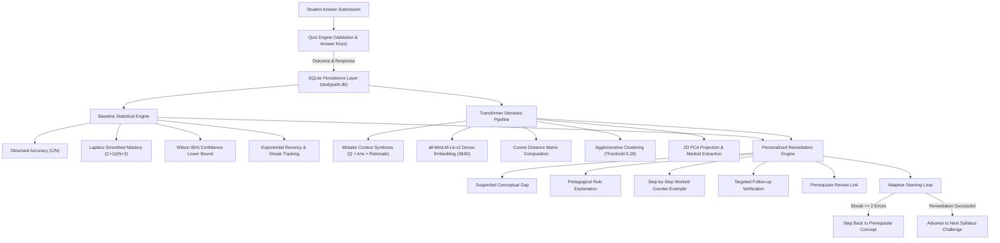

# StudyPath — A Personalized Concept-Gap Tutor

**Course:** CSET214: Data Analysis Using Python  
**Project Title:** StudyPath — A Personalized Concept-Gap Tutor for Digital Logic and Boolean Algebra  
**Technologies:** Python, Pandas, NumPy, Scikit-learn, Sentence-Transformers (`all-MiniLM-L6-v2`), PyTorch, Plotly, Streamlit, SQLite

---

## 1. Executive Summary & Problem Statement

Most educational assessment software merely grades student answers as binary binary outcomes (correct vs. incorrect) and presents an entire textbook chapter when a student fails. However, in STEM topics like digital logic and Boolean algebra, an incorrect answer is usually caused by a **specific, recurring conceptual misunderstanding** (e.g. failing to toggle conjunction to disjunction in De Morgan's theorem), rather than a general failure to understand the whole topic.

**StudyPath** solves this by:
1. Identifying recurring misconceptions across differently worded questions.
2. Estimating concept-level mastery using a **Bayesian Laplace-smoothed posterior** and **Wilson score confidence interval** to prevent premature mastery or failure classifications.
3. Mapping student errors into a **384-dimensional dense semantic embedding space** using `sentence-transformers` (`all-MiniLM-L6-v2`).
4. Clustering mistakes with **distance-threshold Agglomerative Hierarchical Clustering** to isolate underlying misconception patterns regardless of surface question phrasing.
5. Providing structured, 5-part remedial explanations with step-by-step counter-examples and interactive follow-ups.
6. Adaptively steering the student's next question, including stepping back to foundational prerequisites when repeated errors occur.

---

## 2. Central Research Question & Findings

> **Research Question:** *"Can semantic embeddings of student mistakes improve the identification of recurring conceptual gaps compared with simple concept-tag-based error counting?"*

### Empirical Benchmark Findings ($N=20$ Mistakes across 4 Syllabus Concepts)
| Evaluation Metric | Baseline (Concept-Tag Grouping) | StudyPath (Transformer Embeddings) | Margin ($\Delta$) |
| :--- | :---: | :---: | :---: |
| **Adjusted Rand Index (ARI)** | `0.4214` | **`0.6697`** | **`+0.2483` (+58.9% relative gain)** |
| **Normalized Mutual Info (NMI)**| `0.6582` | **`0.8114`** | **`+0.1532`** |
| **Misconception Granularity** | 4 broad subject buckets | 8 discrete pedagogical clusters | High-resolution diagnosis |

### Key Qualitative Findings
1. **Cross-Concept Misconception Discovery:** A student who fails to flip the operator in De Morgan's theorem (`(A.B)' -> A'.B'`) often commits the exact same error when synthesizing an OR gate from NANDs (`universal_logic`). Concept-tag counting segregates these into two distinct buckets; StudyPath's semantic embeddings unify them into a single diagnosed gap.
2. **Intra-Concept Disambiguation:** Under the single umbrella tag `boolean_laws`, one student may neglect absorption identities (`A + AB = A`), while another confuses Boolean addition with real integer arithmetic (`A + A = 2A`). Concept-tagging lumps both together as "weakness in Boolean laws," whereas semantic clustering separates them into distinct pedagogical remedies.

---

## 3. System Architecture & Data Flow



---

## 4. Machine Learning & Data Science Methodology

### 4.1 Dense Semantic Embeddings
- **Model:** `sentence-transformers` using `all-MiniLM-L6-v2` (384-dimensional dense vectors, normalized to unit L2 norm).
- **Composite Context Formulation:** To ensure clustering captures conceptual mechanics rather than question wording, the embedded text string is synthesized as:
  $$\text{Context} = \text{Concept} \parallel \text{Question Text} \parallel \text{Student Answer} \parallel \text{Expected Form} \parallel \text{Error Rationale} \parallel \text{Reasoning}$$
- **Similarity Metric:** Pairwise Cosine Similarity:
  $$\text{CosineSim}(\mathbf{u}, \mathbf{v}) = \frac{\mathbf{u} \cdot \mathbf{v}}{\|\mathbf{u}\|_2 \|\mathbf{v}\|_2}$$
  Cosine Distance is computed as $D(\mathbf{u}, \mathbf{v}) = 1 - \text{CosineSim}(\mathbf{u}, \mathbf{v})$.

### 4.2 Distance-Threshold Hierarchical Clustering
- **Algorithm:** Average-linkage Agglomerative Clustering with a precomputed cosine distance threshold of $0.28$ (corresponding to a minimum cosine similarity of $0.72$).
- **Handling Unknown $K$:** Because the number of misconceptions in a cohort is unknown beforehand, centroid-based algorithms like KMeans (which require fixed $K$) are inadequate. Distance-threshold clustering groups points based on natural semantic density.
- **Outlier Rejection:** Isolated responses whose nearest neighbor has distance $> 0.28$ are assigned cluster `-1` (Noise/Outlier) rather than artificially forced into a cluster.
- **Representative Medoids:** For each cluster, the sample with maximum intra-cluster mean cosine similarity is identified as the cluster medoid.

### 4.3 Statistical Mastery Baseline
- **Observed Accuracy:** $\hat{p} = \frac{C}{N}$
- **Laplace Smoothed Mastery (Beta-Binomial posterior mean with prior $\alpha=1, \beta=1$):**
  $$M_{\text{Laplace}} = \frac{C + 1}{N + 2}$$
  *Justification:* Prevents a single lucky guess from scoring 100% or an early mistake from dropping mastery to 0%.
- **Wilson Score 95% Confidence Lower Bound:**
  $$W_{\text{lower}} = \frac{\hat{p} + \frac{z^2}{2N} - z\sqrt{\frac{\hat{p}(1-\hat{p})}{N} + \frac{z^2}{4N^2}}}{1 + \frac{z^2}{N}}, \quad z=1.96$$
  *Justification:* Rigorously penalizes small sample sizes, ensuring high confidence is only granted with repeated evidence.
- **Provisional Mastery Criterion:**
  $$\text{Status} = \text{"Provisionally Mastered"} \iff N \ge 3 \land M_{\text{Laplace}} \ge 0.80 \land \text{Streak} \ge 2$$

---

## 5. Project Directory Structure

```
studypath/
│
├── app.py                      # Main Streamlit analytics application & UI
├── requirements.txt            # Locked, compatible dependencies
├── README.md                   # Comprehensive project documentation
├── .env.example                # Template for optional LLM API keys
├── .gitignore                  # Git exclusion rules
│
├── data/
│   ├── concepts.json           # 4 Boolean Algebra syllabus units & prerequisites
│   ├── questions.json          # 16 verified questions with distractor mappings
│   ├── benchmark_dataset.json  # 24 curated student benchmark responses
│   └── studypath.db            # Persistent SQLite database (auto-generated)
│
├── database/
│   ├── __init__.py
│   ├── db.py                   # Thread-safe SQLite ORM & data access layer
│   └── schema.sql              # Relational schema (sessions, attempts, mastery)
│
├── models/
│   ├── __init__.py
│   ├── baseline.py             # Laplace smoothing, Wilson bounds, recency
│   ├── embedding_model.py      # all-MiniLM-L6-v2 pipeline with offline cache
│   ├── clustering.py           # Cosine Agglomerative clustering & PCA projection
│   ├── evaluation.py           # Benchmark experiment (ARI, NMI, case studies)
│   └── weights/                # Local model weights directory
│
├── services/
│   ├── __init__.py
│   ├── quiz_service.py         # Question engine & verified key validation
│   ├── explanation_service.py  # 5-part diagnostic remediation & rule bank
│   └── mastery_service.py      # Adaptive state machine & prerequisite router
│
├── components/
│   ├── __init__.py
│   └── ui_helpers.py           # Dark-theme Plotly visualizations & card styling
│
└── tests/
    ├── __init__.py
    ├── test_database.py        # Database schema, sessions, and attempts (6 tests)
    ├── test_quiz.py            # Question bank & verified answer keys (5 tests)
    ├── test_baseline.py        # Laplace smoothing & status transitions (5 tests)
    ├── test_clustering.py      # Embeddings, clustering & PCA projection (5 tests)
    ├── test_mastery.py         # Adaptive loop & prerequisite transitions (3 tests)
    └── test_evaluation.py      # Benchmark experiment execution (2 tests)
```

